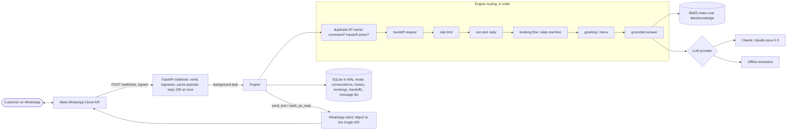

# WhatsApp AI Assistant

A WhatsApp customer-service assistant for small businesses, built on the official
**WhatsApp Cloud API**. It answers customers' questions from the business's own documents,
takes appointment requests through a guided step-by-step flow, and hands the conversation to
a person when the customer asks for one. It speaks Spanish, Portuguese and English.

The demo business is **Clínica Dental Sonrisa**, a *fictional* dental clinic in Buenos Aires.
Its prices, address and policies are made up for the demo. The whole project runs offline
with no API keys: answers come from a deterministic extractive provider unless you add an
Anthropic API key, in which case Claude writes them.

---

## Contents

- [What it does](#what-it-does)
- [Demo conversation](#demo-conversation)
- [Architecture](#architecture)
- [Quick start: the terminal simulator (no keys)](#quick-start-the-terminal-simulator-no-keys)
- [Run the server](#run-the-server)
- [Connect to the WhatsApp Cloud API](#connect-to-the-whatsapp-cloud-api)
- [Deploy on Render](#deploy-on-render)
- [Configuration](#configuration)
- [Security notes](#security-notes)
- [Testing](#testing)
- [Limitations](#limitations)
- [Project layout](#project-layout)
- [License](#license)

## What it does

**Grounded answers from the business's documents (RAG)**
- The knowledge base is plain Markdown: 8 short documents per language in
  `data/knowledge/{es,pt,en}/`. They cover prices and services, opening hours, the address and
  directions, payment methods and insurance, the booking and cancellation policy, the first
  visit, emergencies and children's care.
- Documents are split into one passage per heading and ranked with **Okapi BM25**, written in
  pure Python with no embeddings and no vector database. Before ranking, text is folded to
  lower case without accents, each language's stopwords are dropped and plurals are lightly
  stripped.
- The top 3 passages come from the customer's language. When those are missing or weak, the
  documents of every language are searched as well.
- Each answer ends with a source tag such as `(Fuente: Horarios)`. When nothing relevant is
  found, the bot says it doesn't know and offers a person instead of guessing.

**Two answer providers behind one interface**
- **Claude** (`AnthropicProvider`) uses the official `anthropic` SDK:
  - model `claude-opus-5-5` at effort `low`, `max_tokens` 1024;
  - server-side refusal fallbacks (`fallbacks="default"`);
  - a static system prompt marked for prompt caching;
  - the retrieved passages go in the user turn;
  - `stop_reason` is checked on every reply, and only text blocks are kept.

  If a Claude call fails for any reason (rate limit, 5xx, 4xx, connection error), the bot
  sends the offline answer instead.
- **Offline** (`OfflineProvider`) is deterministic and extractive. It returns the best
  passage's most relevant sentences plus the source tag. If the BM25 score is below a
  threshold, it returns the "don't know, talk to a person" reply. Tests and the simulator use
  it, and so does the server when no `ANTHROPIC_API_KEY` is set.

**Language detection (es / pt / en)**
- A heuristic counts marker words that belong to only one language, plus character signals:
  `ñ ¿ ¡` for Spanish; `ã õ ç` and the digraphs `nh`/`lh` for Portuguese.
- The language is sticky per conversation. It changes only when a message carries clear
  evidence of another language.

**Appointment requests: a deterministic state machine, not the LLM**
- Started by `turno`, `cita`, `agendar`, `reservar`, `agendamento`, `marcar … consulta`,
  `book` or `appointment`.
- Questions about bookings, such as "¿cuánto cuesta un turno?" or "¿cómo cancelo mi turno?",
  go to the knowledge base instead of starting a booking.
- The steps are:
  1. **Service:** a numbered list from `data/business.toml`.
  2. **Date:** `DD/MM`, `DD/MM/YYYY`, `YYYY-MM-DD`, `mañana`/`amanhã`/`tomorrow` or
     `hoy`/`hoje`/`today`. The date is rejected if it is in the past, more than 60 days
     ahead, or a day the clinic is closed.
  3. **Time:** `HH:MM`, or forms such as `10hs` or `3pm`. The appointment must fit inside that
     day's opening hours and must not be in the past.
  4. **Patient name.**
  5. **Confirmation:** `sí/si/sim/yes` or `no`.
- `cancelar` or `cancel` leaves the flow at any step.
- A confirmed request is saved with status `requested`; the clinic confirms it with the
  patient. If an owner number is configured, the owner gets a WhatsApp alert.

**Human handoff**
- Starts on `humano`, `persona`, `pessoa`, `agente`, `atendente`, `human`, `agent`,
  `operador` or `operator`, in a short message or one that asks to talk to someone ("quiero
  hablar con una persona"). A long question that only mentions a "persona" is answered
  normally.
- The bot replies with a localized message. Outside opening hours it adds when the team will
  answer: "the next business day", with the day and time, or "today from 09:00" before
  opening.
- A handoff record is stored and the owner (`WA_OWNER_PHONE`) gets a WhatsApp alert with the
  customer's number and last message.
- While handed off, the bot stays silent for that customer and relays their messages to the
  owner. Silence ends after `WA_HANDOFF_TTL_HOURS` (24 h by default), or when the owner sends
  `/bot on <number>`.
- The owner can answer the customer through the bot with `/reply <number> <message>`.

**Reliability and safety**
- `GET /webhook` verification: checks `hub.mode=subscribe` and `hub.verify_token`, returns
  `hub.challenge` as plain text, otherwise 403.
- `POST /webhook` checks `X-Hub-Signature-256` (HMAC-SHA256 of the raw body with the App
  Secret, compared with `hmac.compare_digest`) and returns 401 when it is invalid or missing.
  The check is skipped only when `WA_APP_SECRET` is empty **and** `WA_ENV=dev`, with a startup
  warning.
- The webhook answers 200 at once and processes messages in a FastAPI background task, so
  Meta's retry-on-slow-response does not kick in.
- Idempotency: processed WhatsApp message ids are stored for 8 days, so duplicates and Meta
  retries are ignored. Messages from the same customer are handled one at a time.
- `statuses` events (sent, delivered, read) are ignored.
- `text` and `interactive` messages are read; for `interactive`, the title of the
  button or list reply is the text. Any other type (image, audio, sticker…) gets a localized
  "I can only read text for now".
- Per-customer rate limit: 8 messages per minute by default. One polite reply is sent per
  window and further messages are dropped silently.
- Outbound text is truncated to WhatsApp's 4096-character limit. Messages are marked as read.
- Logs mask phone numbers (`+15*******01`) and never contain message bodies, at any level.
- Customer text is treated as untrusted. It is escaped and wrapped in `<customer_message>`
  tags, and the system prompt tells the model to ignore instructions that try to change its
  role or reveal the prompt.
- The conversation history sent to the LLM is bounded to the last `WA_HISTORY_TURNS`
  question/answer pairs (6 by default).

**Extras**
- Opening hours (Mon–Fri 09:00–19:00, Sat 09:00–13:00, closed Sunday) are set in
  `data/business.toml`, read with the standard-library `tomllib`. Time-zone math uses
  `zoneinfo` + `tzdata` (America/Argentina/Buenos_Aires).
- `hola` / `oi` / `hello` / `menu` get a short localized menu: ask a question, book, or talk
  to a person.
- `GET /admin/bookings` and `GET /admin/handoffs` require `Authorization: Bearer
  <WA_ADMIN_TOKEN>`, compared in constant time. They return 401 for a wrong or missing token
  and 404 when no admin token is configured.
- `GET /healthz`. The interactive API docs (`/docs`) are served only when `WA_ENV=dev`.
- `python -m wa_assistant.simulate` runs a terminal simulator of the full engine.

## Demo conversation

Real output of the terminal simulator with the offline provider (no API key, no WhatsApp),
pinned to a Wednesday at 10:00 in Buenos Aires:

```text
$ python -m wa_assistant.simulate --now 2026-10-14T10:00 < demo-es.txt
Clínica Dental Sonrisa - WhatsApp assistant simulator
answers: offline | customer: +15*******01 | type /quit to exit

you> hola
bot> ¡Hola! Soy el asistente virtual de Clínica Dental Sonrisa. Puedo ayudarte con:
     - Preguntas sobre precios, horarios, ubicación, pagos y más: escribí tu pregunta.
     - Pedir un turno: escribí "turno".
     - Hablar con una persona del equipo: escribí "humano".

you> ¿Cuánto cuesta una limpieza?
bot> Limpieza dental (profilaxis): ARS 45.000.

     (Fuente: Precios y servicios)

you> ¿Venden cepillos eléctricos?
bot> No tengo esa información en mis documentos y prefiero no inventar. ¿Querés hablar con una persona del equipo? Escribí "humano".

you> Quiero un turno
bot> ¡Vamos a pedir tu turno! ¿Qué servicio necesitás? Respondé con el número:
     1. Consulta y control general
     2. Limpieza dental
     3. Blanqueamiento
     4. Consulta de ortodoncia
     5. Odontopediatría (niños)
     (Escribí "cancelar" para salir.)

you> 2
bot> Perfecto: Limpieza dental. ¿Para qué fecha? Escribí DD/MM (por ejemplo 15/10) o "mañana".

you> 18/10
bot> El domingo 18/10/2026 la clínica está cerrada. Atendemos: lunes a viernes 09:00-19:00; sábado 09:00-13:00. ¿Qué otra fecha te queda bien?

you> mañana
bot> ¿A qué hora? El jueves 15/10/2026 el primer turno es a las 09:00 y el último a las 18:30. Escribí la hora como HH:MM.

you> 10:30
bot> ¿A nombre de quién pido el turno? (nombre y apellido del paciente)

you> Ana García
bot> Revisá tu solicitud:
     - Servicio: Limpieza dental
     - Fecha: jueves 15/10/2026 a las 10:30
     - Paciente: Ana García
     ¿Confirmás? Respondé "sí" o "no".

you> sí
bot> ¡Listo! Registramos tu solicitud de turno #1. El equipo te va a confirmar el horario por este chat dentro del horario de atención.

you> quiero hablar con una persona
bot> Listo, le aviso a una persona del equipo para que siga la conversación por este chat. Mientras tanto no voy a responder automáticamente.

you> ¿Hola? ¿Siguen ahí?
     (no reply: the bot stays silent)
```

`demo-es.txt` holds one customer message per line, the `you>` lines above.

## Architecture



| Module (`src/wa_assistant/`) | Responsibility |
|---|---|
| `app.py` | App factory `create_app(settings, sender=..., llm=..., clock=...)`, webhook and admin routes |
| `payloads.py` | Pydantic models of the Meta webhook payload, message extraction |
| `security.py` | Signature verification, constant-time token comparison |
| `engine.py` | Routing, handoff, owner commands, rate-limit decisions, outbound sending |
| `booking.py` | Booking state machine and date/time/name parsing |
| `knowledge.py` | Markdown chunking and BM25 retrieval |
| `language.py`, `text.py` | Language detection, folding, stopwords, tokenization |
| `i18n.py` | Every customer- and owner-facing string in es/pt/en |
| `llm.py` | `LLMProvider` protocol, `AnthropicProvider`, `OfflineProvider` |
| `whatsapp.py` | `MessageSender` protocol and the Graph API client |
| `storage.py` | Thread-safe SQLite repository (one connection, a lock, WAL) |
| `hours.py`, `config.py` | Opening hours; settings (`WA_*`) and `business.toml` |
| `ratelimit.py`, `logging_utils.py` | Per-user rate limiter; phone masking and logging setup |
| `simulate.py` | Terminal simulator |

## Quick start: the terminal simulator (no keys)

Requires Python 3.12+.

```bash
python -m venv .venv
source .venv/bin/activate          # Windows: .venv\Scripts\activate
pip install -e ".[dev]"

python -m wa_assistant.simulate              # chat interactively (language is detected)
python -m wa_assistant.simulate --lang pt    # start in Portuguese
```

Options:
- `--phone <digits>`: the simulated customer's number.
- `--now 2026-10-14T10:00`: pin the business-local time, for reproducible demos.
- `--rate-limit N`: turn the per-user limit on. It is off by default in the simulator,
  because a pasted script sends messages faster than any person would.
- `--db file.db`: keep the data between runs. It is in memory by default.

Run the simulator from the project root, so that `data/` is found (or set `WA_DATA_DIR`). It
uses Claude when `ANTHROPIC_API_KEY` is set and the offline provider otherwise.

## Run the server

```bash
cp .env.example .env               # Windows: copy .env.example .env
# edit .env: at least WA_VERIFY_TOKEN, WA_APP_SECRET, WA_ACCESS_TOKEN, WA_PHONE_NUMBER_ID
uvicorn wa_assistant.app:create_app --factory --host 0.0.0.0 --port 8000 --no-access-log
curl http://127.0.0.1:8000/healthz   # {"status":"ok"}
```

`--no-access-log` keeps the verify token out of the logs: Meta sends it in the query string
of the verification request.

Meta must reach your webhook over public HTTPS. For local testing, expose port 8000 with a
tunnel such as ngrok or Cloudflare Tunnel and use the tunnel's URL below.

With Docker:

```bash
docker build -t whatsapp-ai-assistant .
docker run --rm -p 8000:8000 --env-file .env whatsapp-ai-assistant
```

The image is based on `python:3.12-slim`, runs as an unprivileged user (uid 10001), listens
on `$PORT` (default 8000) and has a health check on `/healthz`.

## Connect to the WhatsApp Cloud API

1. **Create a Meta developer app.** At [developers.facebook.com](https://developers.facebook.com/apps),
   choose *Create app* and pick the **Business** app type. In the newer flow, pick the use case
   *Connect with customers through WhatsApp*. Link it to a Meta business portfolio.
2. **Add the WhatsApp product** to the app. Open *WhatsApp > API Setup*.
3. **Use the free test number.** Meta gives the app a test business number. It can message
   **up to 5 recipient numbers**, and each one must be added and verified with a code on the
   *API Setup* page. Add your own phone. If you set `WA_OWNER_PHONE`, add that number too.
4. **Copy the IDs and token.** Set the *Phone number ID* (not the phone number itself) as
   `WA_PHONE_NUMBER_ID`. Set the access token shown there as `WA_ACCESS_TOKEN`.
   - That **temporary access token expires** after about 24 hours.
   - For anything longer-lived, create a **System User** in Business Settings, give it the
     app and the WhatsApp account with the `whatsapp_business_messaging` and
     `whatsapp_business_management` permissions, and generate a token for it.
5. **Set the App Secret.** Find it in *App settings > Basic > App secret* and set it as
   `WA_APP_SECRET`. The server uses it to check the `X-Hub-Signature-256` header on every
   webhook call.
6. **Configure the webhook.** Pick any long random string as `WA_VERIFY_TOKEN` and start the
   server. Then go to *WhatsApp > Configuration > Webhook*:
   - Callback URL: `https://<your-host>/webhook`
   - Verify token: the same string as `WA_VERIFY_TOKEN`

   Click *Verify and save*. Meta calls `GET /webhook` and expects the challenge back.
7. **Subscribe to the `messages` field** in the webhook fields list.
8. **Test it.** From a verified recipient phone, send "hola" to the test number. The bot
   answers within the 24-hour customer-service window that the customer's message opens.

## Deploy on Render

`render.yaml` is a Render Blueprint for a Docker web service with a health check on
`/healthz`.

1. Push the repository to GitHub.
2. In Render, choose **New > Blueprint** and select the repository.
3. Fill in the values marked `sync: false`. They are prompted in the dashboard and never
   stored in git: `WA_VERIFY_TOKEN`, `WA_APP_SECRET`, `WA_ACCESS_TOKEN`, `WA_PHONE_NUMBER_ID`,
   `WA_OWNER_PHONE`, `WA_ADMIN_TOKEN` and, optionally, `ANTHROPIC_API_KEY`.
4. When the deploy is live, open `https://<service>.onrender.com/healthz`. Then use
   `https://<service>.onrender.com/webhook` as the callback URL in step 6 above.

Things to know about the free plan:
- The instance sleeps when idle, so the first message after a pause is answered slowly.
- Its filesystem is ephemeral, so the SQLite database is wiped on every restart or deploy.

For real use, choose a paid instance with a persistent disk and point `WA_DB_PATH` at it.

## Configuration

Every setting is an environment variable (or a line in `.env`). `.env.example` lists them all
with comments.

| Variable | Default | Purpose |
|---|---|---|
| `WA_ENV` | `prod` | `dev` or `prod`. Only `dev` may skip the signature check (empty app secret); only `dev` serves `/docs` |
| `WA_LOG_LEVEL` | `INFO` | `DEBUG`, `INFO`, `WARNING`, `ERROR` |
| `WA_DATA_DIR` | `data` | Folder with `business.toml` and `knowledge/` |
| `WA_DB_PATH` | `var/wa_assistant.db` | SQLite file (`:memory:` keeps nothing) |
| `WA_VERIFY_TOKEN` | *(empty)* | Webhook verify token. Empty means `GET /webhook` always answers 403 |
| `WA_APP_SECRET` | *(empty)* | Meta App Secret for `X-Hub-Signature-256`. Empty outside dev means every POST gets 401 |
| `WA_ACCESS_TOKEN` | *(empty)* | Graph API bearer token (temporary or System User) |
| `WA_PHONE_NUMBER_ID` | *(empty)* | Sender phone number ID |
| `WA_GRAPH_VERSION` | `v23.0` | Graph API version |
| `WA_GRAPH_BASE_URL` | `https://graph.facebook.com` | Graph API host |
| `WA_HTTP_TIMEOUT_SECONDS` | `10` | Timeout per Graph API call (one retry on 5xx and connection errors) |
| `WA_MARK_AS_READ` | `true` | Mark incoming messages as read |
| `WA_OWNER_PHONE` | *(empty)* | Owner's WhatsApp number: receives alerts and relayed messages, may send `/bot on` and `/reply` |
| `WA_ADMIN_TOKEN` | *(empty)* | Bearer token for `/admin/*`. Empty means the admin API answers 404 |
| `WA_HANDOFF_TTL_HOURS` | `24` | How long the bot stays silent after a handoff |
| `WA_RATE_LIMIT_PER_MINUTE` | `8` | Messages per minute per customer (`0` disables the limit) |
| `WA_LLM_PROVIDER` | `auto` | `auto` (Claude when `ANTHROPIC_API_KEY` is set), `anthropic` or `offline` |
| `WA_LLM_MODEL` | `claude-opus-5-5` | Claude model id |
| `WA_LLM_EFFORT` | `low` | `low`, `medium`, `high`, `xhigh`, `max`; sent as `output_config.effort` |
| `WA_LLM_MAX_TOKENS` | `1024` | Reply length cap |
| `WA_LLM_FALLBACKS` | `true` | Server-side refusal fallbacks (`fallbacks="default"`) |
| `WA_HISTORY_TURNS` | `6` | Previous question/answer pairs sent to the LLM |
| `WA_RETRIEVAL_TOP_K` | `3` | Passages retrieved per question |
| `WA_OFFLINE_MIN_SCORE` | `1.5` | Minimum BM25 score for the offline provider to answer, and below which other languages are searched too |
| `ANTHROPIC_API_KEY` | *(empty)* | Read without the `WA_` prefix. Enables Claude in `auto` mode |

The business itself (name, time zone, languages, weekly opening hours, appointment length,
booking horizon and services) lives in `data/business.toml`. The answers come from
`data/knowledge/{es,pt,en}/*.md`. Replace both to adapt the bot to another business.

## Security notes

- **Authentic webhooks only.** Every POST must carry a valid HMAC-SHA256 signature of its
  raw body, compared in constant time; otherwise the request gets 401 and nothing is
  processed.
  - Production fails closed: with no app secret configured, nothing is accepted.
  - The webhook verify token and the admin token are also compared in constant time.
- **The LLM cannot act.** Claude only writes answer text, from the retrieved passages.
  Booking, handoff, owner commands and rate limiting are deterministic code. The model has no
  tools.
- **Prompt injection.** Customer text is HTML-escaped and wrapped in `<customer_message>` tags,
  so it cannot close its own tag. The system prompt calls it untrusted and tells the model to
  ignore requests to change its role or reveal the prompt. No model is fully immune to prompt
  injection. Here the damage it could do is limited to the wording of one reply.
- **Refusals.** `stop_reason` is always checked, and a refusal becomes a localized "a person
  from the team can help" message. Server-side fallbacks (`server-side-fallback-2026-07-01`,
  `fallbacks="default"`) let Anthropic retry a declined request on its recommended fallback
  model.
- **Secrets** come only from the environment, are held as `SecretStr` and are never logged.
  `.env` is git-ignored. The container runs uvicorn with `--no-access-log`, because Meta's
  verification request carries the verify token in its URL.
- **Privacy.**
  - Logs mask phone numbers and never contain message bodies.
  - The database stores what the bot needs: the last 50 messages (questions and answers) per
    customer for the LLM context, booking requests with patient names, handoff records and
    message ids.
  - Whoever deploys it is responsible for local data-protection law (for example Argentina's
    Ley 25.326 or Brazil's LGPD) and for a retention policy.
- **Abuse.** A per-customer rate limit, which also applies to messages relayed to the owner,
  payload validation with Pydantic and outbound truncation keep one sender from flooding the
  bot or the owner.
- **Container.** The container runs as a non-root user and holds no development tools.

## Testing

```bash
ruff check .
ruff format --check .
mypy                     # strict
pytest --cov             # 245 tests, 98% line+branch coverage, no network or keys needed
```

The suite uses FastAPI's `TestClient`, a recording fake sender, a fake clock and a fake
Anthropic client. It covers:
- **Webhook:** valid, invalid, tampered and missing signatures; verification (200/403);
  duplicate deliveries; ignored `statuses`; non-text and interactive messages; invalid JSON.
- **Admin auth:** 401, 404 and 200 responses.
- **Language and retrieval:** language detection in all three languages, and BM25 returning
  the right document for sample questions in each language.
- **Offline answers:** the "don't know" path.
- **Booking flow:** the happy path; invalid, past, far and closed-day dates; invalid,
  out-of-hours and past times; cancelling mid-flow; answering "no" at confirmation.
- **Handoff:** silence, relaying to the owner, TTL expiry, `/bot on`, `/reply`, and the
  after-hours and before-opening messages.
- **Limits, logs and the Graph client:** rate limiting; masked logs with no bodies;
  truncation to 4096; the client's payloads, retries and Graph error messages.
- **`AnthropicProvider` (no network):**
  - request shape: effort, fallbacks, no `thinking` parameter, cached static system prompt,
    passages in the user turn;
  - text extraction that skips `thinking` blocks;
  - refusal and `max_tokens` handling;
  - degradation to the offline answer on every API error class;
  - bounded history and tag escaping.
- **Simulator:** a scripted end-to-end run.

CI (`.github/workflows/ci.yml`) runs the same four checks on Python 3.12 and 3.13 with a
read-only token.

## Limitations

- **The demo data is fictional.** The clinic, its prices, address and policies are invented.
- **Retrieval is keyword-based (BM25), not embeddings.** Paraphrases that share no words with
  the documents can be missed. Short, FAQ-style headings in the documents help.
- **Language detection is a heuristic.** Very short messages keep the conversation's current
  language.
- **The booking flow takes requests, it does not manage a calendar.** It knows the weekly
  opening hours but not public holidays, existing appointments or double bookings. Staff
  confirm each request with the patient.
- **There is no agent inbox.** A person takes over through the owner's WhatsApp: the owner
  gets alerts and relayed messages and answers with `/reply`. The admin endpoints list
  bookings and handoffs.
- **WhatsApp's messaging windows apply.**
  - The bot's automatic replies always fall inside the 24-hour window that the customer's
    message opens. An owner `/reply` sent after that window is refused by WhatsApp, and the
    owner is told so.
  - Owner alerts are plain text messages, so WhatsApp delivers them only if the owner messaged
    the business number within the last 24 hours. Sending outside that window needs
    pre-approved template messages, which this project does not implement.
- **Test-number limits.** Meta's free test number can only message up to 5 verified recipient
  numbers.
- **Production needs the client's own number.** That means a verified Meta Business, a phone
  number registered on the Cloud API with an approved display name, and a System User token.
- **One instance only.** Background processing, the rate limiter and SQLite are in-process. A
  message acknowledged with 200 but not yet processed is lost if the process dies at that
  moment. Running several replicas needs a shared database and queue.
- **Meta pricing.**
  - From October 2026, Meta bills *service* messages, the free-form replies sent inside the
    24-hour window, per delivered message, with a monthly free allowance per business number.
  - Every bot reply and owner alert counts.
  - Check [Meta's pricing page](https://developers.facebook.com/docs/whatsapp/pricing) for the
    current rates before quoting costs.
- **Claude costs money and needs an Anthropic API key.** Prompt caching applies only once the
  cached prefix reaches the model's minimum cacheable length, and this short system prompt may
  be below it.

## Project layout

```text
.
├── data/
│   ├── business.toml              # demo business: hours, services, languages
│   └── knowledge/{es,pt,en}/*.md  # 8 documents per language
├── src/wa_assistant/              # the package (see the module table above)
├── tests/                         # pytest suite (no network, no keys)
├── .github/workflows/ci.yml
├── .env.example
├── Dockerfile
├── render.yaml
└── pyproject.toml
```

## License

MIT, see [LICENSE](LICENSE).
